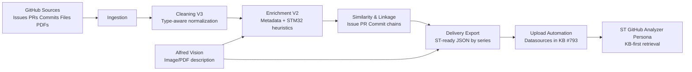
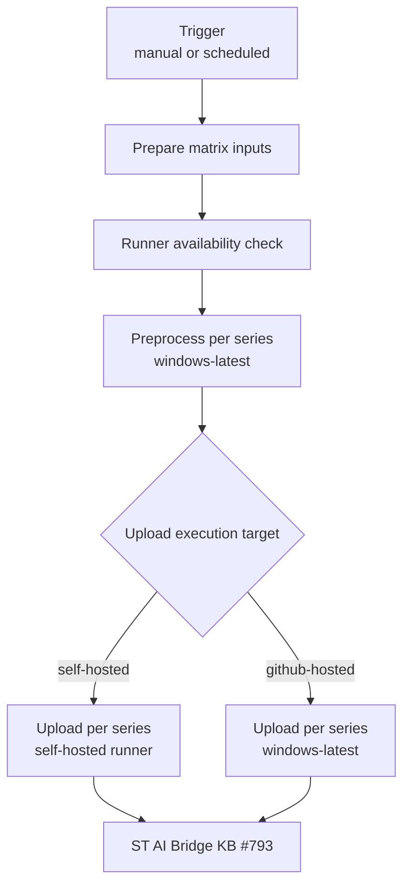

# STM32Cube Data Pipeline for ST Knowledge Base

This repository contains the PFE project developed at STMicroelectronics to transform STM32Cube GitHub data into structured, traceable, and upload-ready knowledge for the ST internal AI assistant.

The current project state is centered on:
- industrial preprocessing of STM32Cube repositories,
- multimodal enrichment for visual evidence (Alfred Vision),
- ST-ready delivery exports,
- automated upload to ST AI Bridge KB,
- CI/CD execution in both self-hosted and github-hosted modes.

## Scope and Current Coverage

- Target ecosystem: STM32Cube public repositories (main series and driver sub-repos)
- Coverage: 25 STM32 series configured
- Delivery outputs: 4 artifact families
  - issues cards
  - files cards
  - resolver cases (issue -> PR -> commit)
  - diagnostic cards
- KB target: ST AI Bridge Knowledge Base `#793`
- Operating model: per-series execution with reproducible automation workflows

## End-to-End Functional Architecture



## CI/CD Automation Architecture



Design intent:
- `github-hosted` path is used for cloud validation and portability.
- `self-hosted` path is used when internal network constraints require local runner execution.

## Repository Layout

```text
PFE_Chatbot_STM32Cube/
├── pipeline/                    # Core preprocessing and export logic
│   ├── ingestion/
│   ├── cleaning/
│   ├── enrichment/
│   ├── similarity/
│   ├── delivery/
│   └── evaluation/
├── pipeline_Automation/         # Workflow orchestration + upload + operational scripts
│   ├── workflow/
│   ├── upload/
│   ├── alfred/
│   └── test_suites/
├── shared/                      # Configs, schemas, shared utils
│   ├── config/
│   ├── schemas/
│   └── utils/
├── datasets/                    # Structured outputs by stage (raw -> delivery)
├── data/                        # Operational/legacy artifacts used by scripts
├── .github/workflows/           # CI/CD workflows
└── requirements.txt
```

## Workflows Used in Production

- `.github/workflows/manual_auto_update_kb.yml`
  - main operational workflow for controlled runs
- `.github/workflows/auto_update_kb.yml`
  - scheduled and manual automated runs
- `.github/workflows/smoke_test_st_api.yml`
  - connectivity/authentication smoke test for ST API

### Supported Modes

- `Prepare`: preprocessing and export only
- `Upload`: upload pre-generated ST-ready outputs only
- `Full`: prepare + upload

### Upload Targets

- `self-hosted`
- `github-hosted`

## Required Secrets (GitHub Actions)

Configure in repository settings:
- `ST_GITHUB_ANALYZER_API_KEY` (required for upload)
- `ST_REMOTE_USER` (recommended)
- one Alfred key alias (or set all three for compatibility)
  - `ST_CHATGPT_API_KEY`
  - `ST_AI_BRIDGE_API_KEY`
  - `ST_API_KEY`
- `RUNNER_CHECK_TOKEN` (recommended for reliable self-hosted availability check)

Compatibility note:
- The three Alfred key names exist for backward compatibility between workflows/scripts.
- Upload authentication uses `ST_GITHUB_ANALYZER_API_KEY`.

## Quick Start (Validation Sequence)

Recommended first validation on a new repo/environment:
1. Run `smoke_test_st_api.yml`.
2. Run `manual_auto_update_kb.yml` with `series=C0`, `mode=Prepare`.
3. Run `manual_auto_update_kb.yml` with `series=C0`, `mode=Upload`, `existing_datasource_mode=Add`.
4. Run `manual_auto_update_kb.yml` with `series=C0`, `mode=Full`.

## Practical Work Guides

Use this section as the operational entry point for day-to-day work.

### For New Team Members

1. Run API smoke validation first.
2. Execute one controlled `Prepare` run on `C0`.
3. Execute one controlled `Upload` run on `C0` with `existing_datasource_mode=Add`.
4. Validate generated datasource IDs and upload logs.

### For Daily Pipeline Operations

1. Prefer `manual_auto_update_kb.yml` for supervised runs.
2. Use `mode=Prepare` to debug preprocessing without touching KB.
3. Use `mode=Upload` only when ST-ready delivery is already validated.
4. Use `mode=Full` for end-to-end production-like execution.
5. Keep `component_issues_only=true` when per-component issues flow is required.

### For Incident Triage

1. If authentication fails, verify `ST_GITHUB_ANALYZER_API_KEY` and `ST_REMOTE_USER` first.
2. If resolver export fails on empty JSON, confirm you are running the latest branch commit.
3. If driver file upload fails with JSON decode, check for empty/LFS-pointer JSON inputs.
4. If self-hosted upload is skipped, inspect runner availability gate and token permissions.

### For Release or Handover

1. Freeze run parameters used for the validated series.
2. Keep datasource ID snapshots under by-series delivery outputs.
3. Archive workflow run links for reproducibility.
4. Run one final `Full` execution on a reference series (recommended: `C0`).

## Operational Notes

- This repository contains very large JSON artifacts; first push can be long.
- GitHub Enterprise warnings around 50 MB files are expected for some generated artifacts.
- `.gitignore` does not untrack files already committed in history.

## Internal Usage

Internal STMicroelectronics PFE project.
