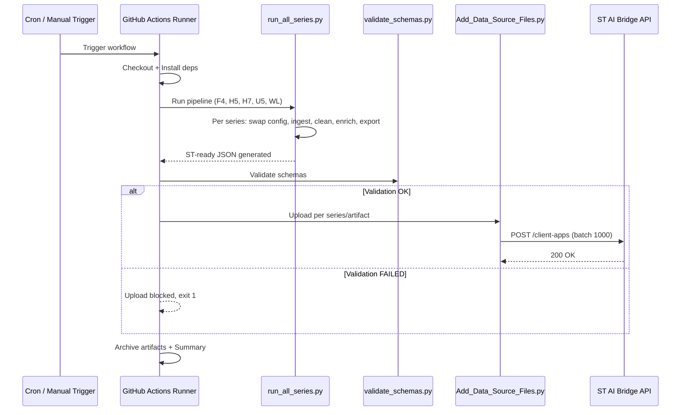

# Automatisation KB — Documentation Technique

## Vue d'ensemble

Le système d'automatisation maintient la Knowledge Base (KB #793) du persona **ST GitHub Analyzer** à jour en exécutant périodiquement :

1. **Ingestion** des données GitHub (issues, PRs, fichiers)
2. **Preprocessing** (nettoyage, enrichissement, similarity, delivery)
3. **Validation** des schémas JSON
4. **Upload** vers la plateforme ST AI Bridge

---

## Architecture

```
┌─────────────────────────────────────────────────────────────────┐
│                    Déclencheurs                                  │
├─────────────────────────────────────────────────────────────────┤
│  • Cron (1er et 15 de chaque mois, 03:00 UTC)                  │
│  • Manuel (GitHub Actions "Run workflow")                       │
│  • Local (PowerShell script)                                    │
└───────────────────────────┬─────────────────────────────────────┘
                            │
                            ▼
┌─────────────────────────────────────────────────────────────────┐
│              Pipeline Orchestrator                               │
│  pipeline_Automation/workflow/run_all_series.py                  │
├─────────────────────────────────────────────────────────────────┤
│  Pour chaque série MCU (F4, H5, H7, U5, WL) :                  │
│    1. Swap config_<series>.json → config.json                   │
│    2. Exécute pipeline/run_full_workflow.py                      │
│    3. Restaure config.json original                             │
└───────────────────────────┬─────────────────────────────────────┘
                            │
                            ▼
┌─────────────────────────────────────────────────────────────────┐
│              Stages du Pipeline                                  │
├─────────────────────────────────────────────────────────────────┤
│  Stage 1: Ingestion (fetch issues, PRs, commits, files)         │
│  Stage 2: Cleaning  (normalisation, détection file_type)        │
│  Stage 3: Enrichment V2 (docs_issues, docs_files)               │
│  Stage 4: Similarity (related_issue_ids)                        │
│  Stage 5: Export ST-ready delivery JSON                         │
└───────────────────────────┬─────────────────────────────────────┘
                            │
                            ▼
┌─────────────────────────────────────────────────────────────────┐
│              Validation Gate                                     │
│  pipeline/evaluation/validate_schemas.py                        │
├─────────────────────────────────────────────────────────────────┤
│  Vérifie chaque JSON contre shared/schemas/*.schema.json        │
│  ❌ Si validation échoue → upload bloqué                        │
└───────────────────────────┬─────────────────────────────────────┘
                            │
                            ▼
┌─────────────────────────────────────────────────────────────────┐
│              Upload KB #793                                      │
│  pipeline_Automation/upload/Add_Data_Source_Files.py             │
├─────────────────────────────────────────────────────────────────┤
│  API: https://api-ai-bridge.st.com/chatgpt/api/client-apps      │
│  Auth: HMAC-SHA1(clientAppName + service + apiKey + ts + nonce)  │
│  Split: 1000 items par requête (--json-split-size)              │
└─────────────────────────────────────────────────────────────────┘
```

---

## Fichiers clés

| Fichier | Rôle |
|---------|------|
| `.github/workflows/auto_update_kb.yml` | GitHub Actions — exécution cloud bi-mensuelle |
| `pipeline_Automation/workflow/run_all_series.py` | Orchestrateur Python multi-séries |
| `pipeline_Automation/workflow/Run_Full_Auto_Update_KB.ps1` | Script local PowerShell (même logique) |
| `pipeline_Automation/upload/Add_Data_Source_Files.py` | Client d'upload vers ST AI Bridge API |
| `shared/config/config_<series>.json` | Configuration par série MCU |

---

## Registre des Datasources (KB #793)

Chaque série MCU a **4 datasources** dans la Knowledge Base :

| Série | Issues | Files | Resolver Cases | Diagnostic Cards |
|-------|--------|-------|----------------|------------------|
| **F4** | 28099 | 28103 | 28118 | 28122 |
| **H5** | 28158 | 28163 | 28164 | 28165 |
| **H7** | 19896 | 21824 | 20403 | 23768 |
| **U5** | 28167 | 28168 | 28244 | 28170 |
| **WL** | 28171 | 28172 | 28245 | 28173 |

---

## Déclenchement

### 1. Automatique (GitHub Actions)

**Fréquence** : 1er et 15 de chaque mois à 03:00 UTC

**Branche** : `main`

Le workflow se déclenche automatiquement via le cron schedule. Il traite toutes les séries (F4, H5, H7, U5, WL).

### 2. Manuel (GitHub Actions)

1. Aller sur : `Actions` → `Auto Update KB` → `Run workflow`
2. Paramètres disponibles :
   - **series** : séries à traiter (ex: `h7` ou `f4,h5`)
   - **skip_ingestion** : réutiliser les données brutes existantes
   - **skip_upload** : mode dry-run (pas d'upload)

### 3. Local (PowerShell)

```powershell
# Toutes les séries
.\pipeline_Automation\workflow\Run_Full_Auto_Update_KB.ps1 -RemoteUser "abir.gharbi@st.com"

# Une seule série, sans ingestion
.\pipeline_Automation\workflow\Run_Full_Auto_Update_KB.ps1 -Series h7 -SkipIngestion

# Dry-run (pas d'upload)
.\pipeline_Automation\workflow\Run_Full_Auto_Update_KB.ps1 -Series f4,h5 -SkipUpload
```

---

## Secrets GitHub requis

| Secret | Valeur | Usage |
|--------|--------|-------|
| `ST_CHATGPT_API_KEY` | Clé API ST AI Bridge | Signe les requêtes d'upload |
| `ST_REMOTE_USER` | Email (ex: `abir.gharbi@st.com`) | Identifie l'utilisateur |
| `GITHUB_TOKEN` | Automatique (fourni par GitHub) | Accès aux repos STM32 |

**Configuration** : Repository Settings → Secrets and variables → Actions → New repository secret

---

## Mécanisme d'authentification API

L'API ST AI Bridge utilise un token HMAC :

```
token = SHA1( clientAppName + serviceName + apiKey + timestamp + nonce )
```

- `clientAppName` = `mdrf_st_github_analyzer`
- `serviceName` = `kb`
- `apiKey` = valeur du secret `ST_CHATGPT_API_KEY`
- `timestamp` = epoch en secondes
- `nonce` = valeur aléatoire

Ce token est envoyé dans chaque requête POST vers l'API.

---

## Format d'upload

Chaque requête POST envoie un JSON avec :

```json
{
  "type": "kb-datasource-add",
  "clientAppName": "mdrf_st_github_analyzer",
  "datasourceId": 19896,
  "rootTagPath": "issues",
  "remoteUser": "abir.gharbi@st.com",
  "token": "<HMAC_SHA1>",
  "timestamp": 1717560000,
  "nonce": "abc123",
  "data": [ ... ]  // max 1000 items par requête
}
```

Les fichiers volumineux sont découpés en batches de 1000 éléments (`--json-split-size 1000`).

---

## Outputs générés

Après exécution, les artefacts sont stockés sous :

```
datasets/07_delivery/st_ready/by_series/
├── stm32cubef4/
│   ├── issues_json/st_ready_issues_stm32cubef4.json
│   ├── files_json/st_ready_files_stm32cubef4.json
│   ├── resolver_cases_json/st_ready_resolver_cases_stm32cubef4.json
│   └── diagnostic_cards_json/st_ready_diagnostic_cards_stm32cubef4.json
├── stm32cubeh5/
├── stm32cubeh7/
├── stm32cubeu5/
└── stm32cubewl/
```

En CI, ces artefacts sont archivés pendant 30 jours via `actions/upload-artifact@v4`.

---

## Gestion des erreurs

| Situation | Comportement |
|-----------|-------------|
| Ingestion échoue pour une série | Continue les autres (`--continue-on-error`) |
| Validation schéma échoue | Upload **bloqué** (gate) |
| Upload HTTP 429/500/503 | Retry automatique (3 tentatives) |
| Fichier delivery absent | Série skippée avec warning |

---

## Logs

- **Cloud** : Visibles dans l'onglet Actions de GitHub
- **Local** : Écrits dans `logs/auto_update_kb_<timestamp>.log`

---

## Diagramme de séquence



---

## Maintenance

### Ajouter une nouvelle série MCU

1. Créer `shared/config/config_<series>.json` avec la liste des repos
2. Ajouter l'entrée dans `SERIES_CONFIGS` de `run_all_series.py`
3. Créer les datasources via ST AI Bridge (ou `create_missing_resolver_datasources.py`)
4. Ajouter les IDs dans le registre (workflow YML + PowerShell)
5. Ajouter la série dans le paramètre `default` du workflow

### Ajouter un nouveau type d'artefact

1. Créer le script d'export dans `pipeline/delivery/`
2. Ajouter le datasource ID dans le registre
3. Ajouter la section d'upload dans le workflow et le script PowerShell
